# SupplyChain-Data-Engineering

An End-to-End Supply Chain Data Engineering and AI Analytics Platform

## Progress

### Architecture
Medallion architecture on Databricks (Unity Catalog, Delta tables): raw files land in Volumes, then Bronze, Silver and Gold tables.

### Bronze layer (done)
- 11 raw Delta tables from CSV, TSV, Excel (3 sheets), nested JSON, invoice text files, image metadata and maintenance logs.
- Every table has audit columns (`_ingested_at`, `_source_file`, `_file_format`). Raw data is kept unchanged, except that spaces in Excel column names became underscores (Delta tables require this).
- Invoices are simulated PDF text files, and the image table is simulated metadata (no real image files).

### Silver layer (7 tables)
- Cleaned: purchase orders, vendors, inventory, deliveries, plants, quality inspections.
- Parsed with regex: invoice text turned into columns (invoice number, date, PO, vendor, total, currency, terms).
- Enforced types, snake_case names, deduplication and standardized values.
- Handled messy delivery data: mixed date formats, inconsistent dock names, blank values.
- Added business rules: stock status, defect rate, severity rank, open/closed and customer-impact flags.
- Checks: row counts, null checks, key uniqueness, and links to purchase orders.

### Gold layer (done)
- Dimensions: `dim_vendors`, `dim_parts`, `dim_plants` (keys unique, no orphan references).
- Fact: `fact_purchase_orders`, enriched with vendor and plant attributes.
- Aggregates: vendor scorecard (weighted composite score), inventory health, and vendor spend by currency.
- KPI snapshot (`gold_consolidated.supply_chain_kpi_snapshot`): 14 headline metrics, each reconciled against its source.
- The data contains 5 currencies, so spend is kept per currency and never added across them. Totals are reconciled against Silver, and there is no total-spend KPI.

### Data quality findings
- Delivery DEL-003 was received with no receiver recorded.
- Ambiguous date format (`06/10/2026`) resolved as month-first, using the surrounding dates.
- Sample inventory has no low-stock parts, so stock-status rules were tested with synthetic rows.
- The vendor scorecard does not yet use inspection results (a vendor with an open critical issue still ranks high).

## Dashboard: Supply Chain Command Center
Built with Databricks AI/BI Dashboards on the Gold layer (10 datasets, 4 pages).
Dataset queries are in `dashboard_datasets.sql`.

### Executive Summary
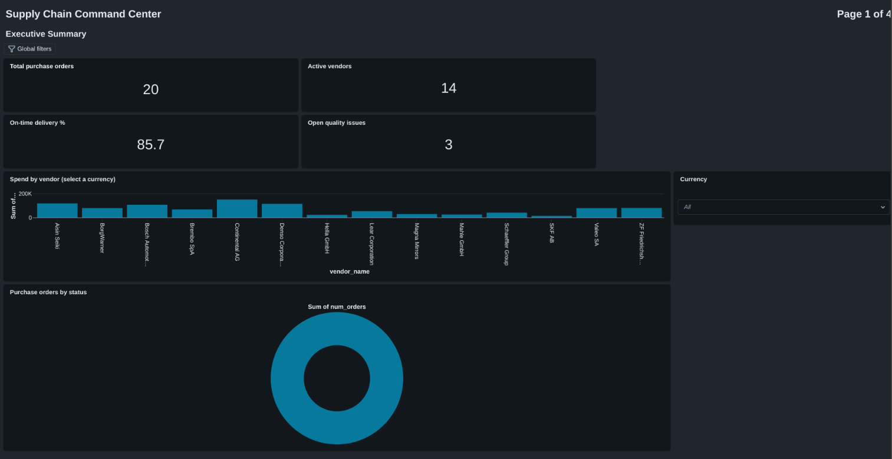

### Vendor Performance
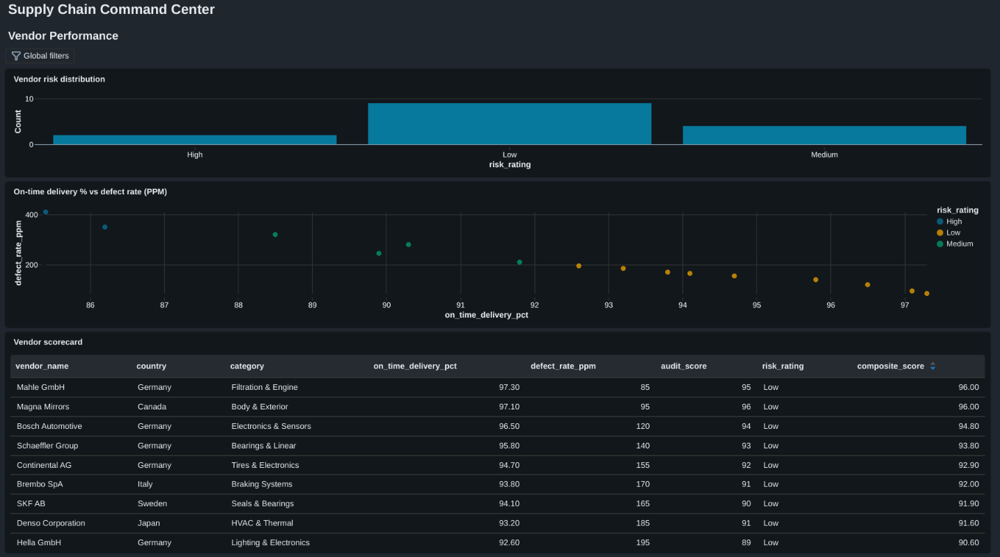

### Inventory Health
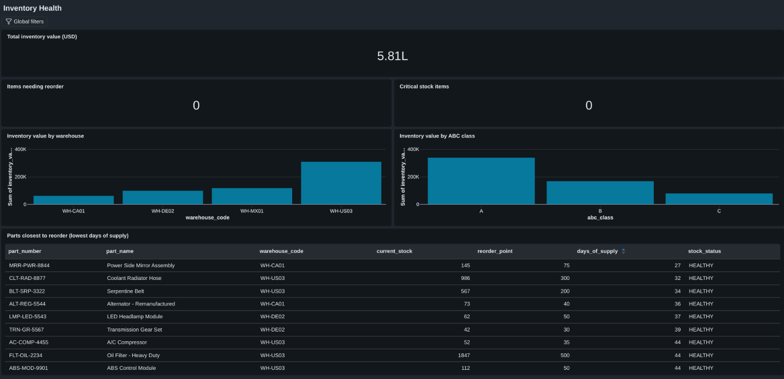

### Quality and Delivery
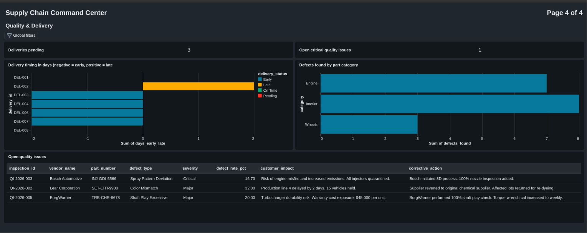

Design notes:
- Spend is shown one currency at a time (the data has 5 currencies, and they are never added together).
- The inventory page highlights the parts closest to reorder, because all 25 parts are currently healthy.
- The delivery chart leaves pending deliveries blank instead of showing zero.
- Part-level inventory, deliveries and open quality issues are read from Silver, because there are no Gold tables for them yet.

## Genie agent
A Genie space ("Supply Chain Analyst") lets users ask questions in plain English over the Gold tables.
- Table and column comments were added to the Gold tables (`14_genie_table_comments`), because Genie relies on them.
- General instructions set the business rules, including that amounts in different currencies are never added or compared.
- Answers were validated against the source tables (`15_genie_validation`). Numbers and rankings matched exactly. Summary wording sometimes drifted (for example, overstating quality grades, or comparing spend across currencies), so narrative claims are checked too.

## Databricks App: Supply Chain Operations Portal
A Gradio web app deployed with Databricks Apps. It reads the Gold tables through a SQL warehouse and shows four tabs: vendor scorecard, inventory health, purchase orders by status, and spend by currency.
- Code: `apps/supply-chain-ops-portal/`
- The app runs under its own service principal, which has read-only access to the Gold schema only (`16_app_permissions`).
- Queries use parameters instead of building SQL from text, and amounts in different currencies are never added together.

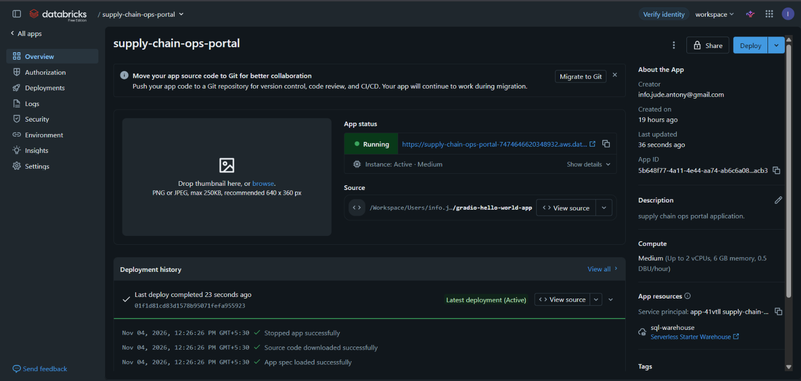
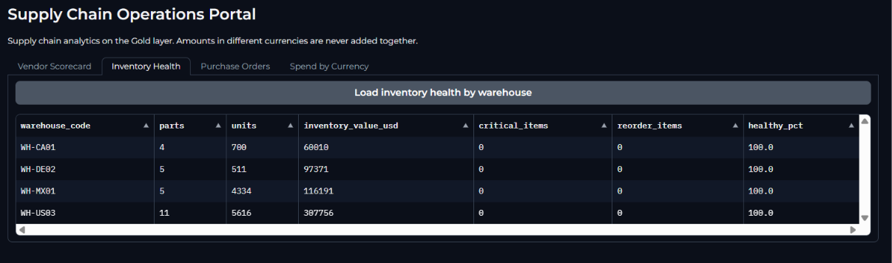
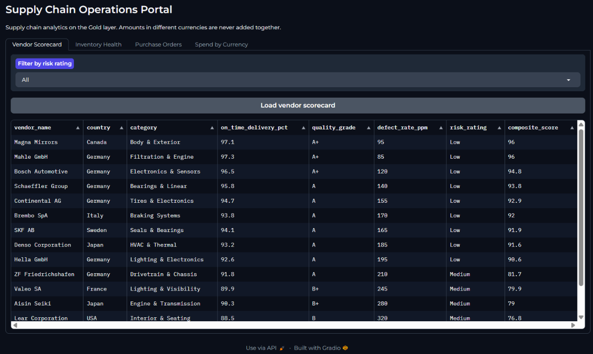
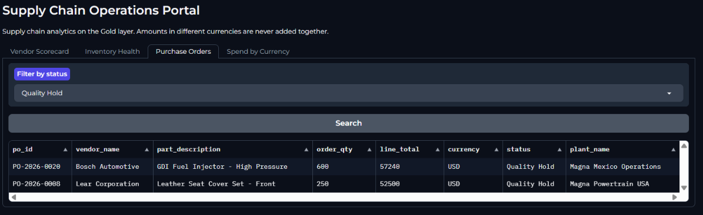
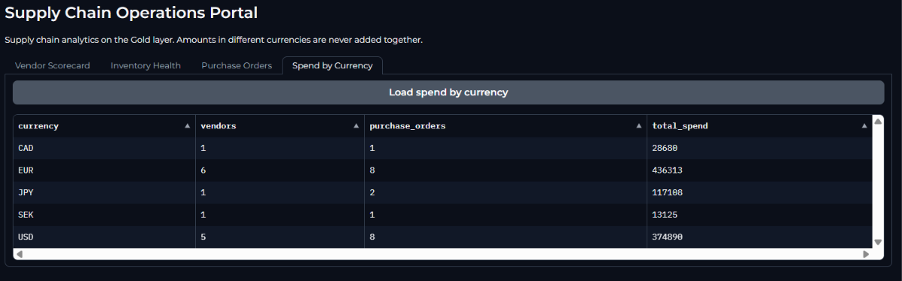

## Orchestration (Lakeflow Jobs)
**Option A- Jobs: runs the notebooks we already have, in order.**

The pipeline is orchestrated as a multi-task Databricks Job: **Supply Chain ETL Pipeline**
(job ID 999645936697666). Each notebook from the medallion layers runs as a task, with
dependencies defining the execution order — bronze tasks run in parallel, silver runs
after its bronze inputs, and gold runs last. Tasks retry once (60s interval) on failure.

**Task graph:**

| Task | Notebook | Depends on |
| --- | --- | --- |
| bronze_csv / bronze_tsv / bronze_excel / bronze_json / bronze_invoices / bronze_images_logs | 02–07 | — (all run in parallel) |
| silver_core | 08_silver_core_tables | bronze_csv, bronze_tsv, bronze_excel |
| silver_invoices | 09_silver_invoices | bronze_invoices, silver_core |
| silver_quality | 12_silver_quality_inspections | bronze_excel |
| gold_dimensions | 10_gold_dimensions | silver_core |
| gold_facts_aggregates | 11_gold_facts_aggregates | gold_dimensions |
| gold_kpi_snapshot | 13_gold_kpi_snapshot | gold_facts_aggregates, silver_quality |

A full run completes end-to-end in ~3.5 minutes (latest successful run: 448955423657070).
The job also has a daily 6:00 AM IST schedule (currently paused).

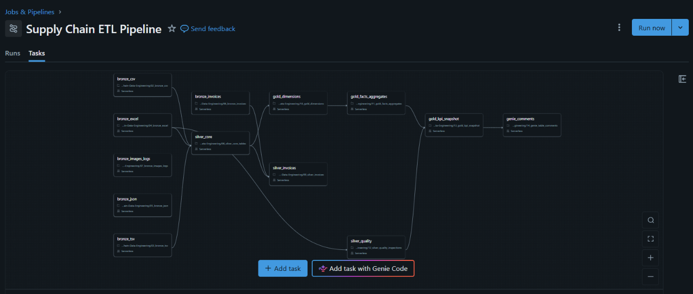
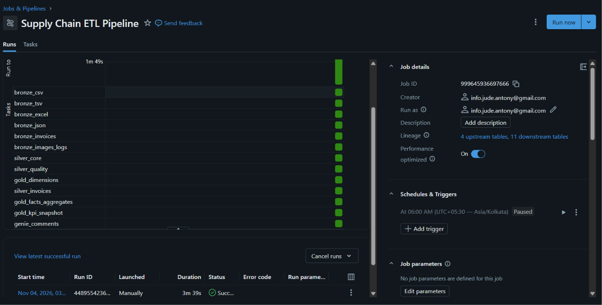
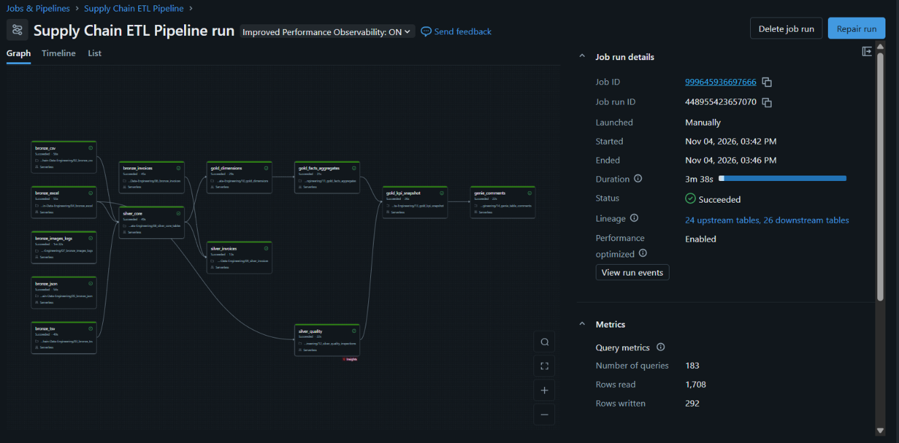
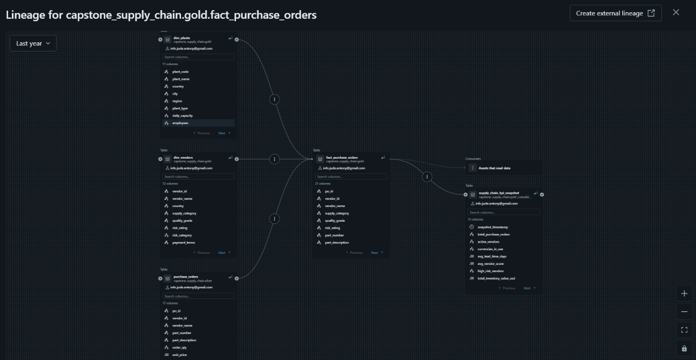

# Supply Chain ETL — Lakeflow Spark Declarative Pipeline

ETL pipeline (bronze → silver → gold) ingesting purchase-order CSVs into Unity Catalog.

**Pipeline:** `supply_chain_sdp` · Catalog/schema: `capstone_supply_chain.sdp_demo`
**Landing volume:** `/Volumes/capstone_supply_chain/bronze/landing_csv/`

## Flow
landing_csv → **bronze_purchase_orders** (Auto Loader, raw) →
**silver_purchase_orders** (cleaned + quality rules) →
**gold_vendor_spend_by_currency** (spend per vendor/currency)

## Quality rules (silver, drop unless noted)
`valid_po_id` · `valid_unit_price` (price > 0) · `valid_order_qty` (qty > 0) · `valid_order_date` (count-only)

## Run
Upload CSVs to the volume → Run (incremental, only new files). Full refresh = rebuild all.

## Test file
`purchase_orders_test.csv` (1 valid + 2 invalid rows) proves the rules: bronze +3, silver +1 (2 dropped), gold +1.## Quality rules (silver, drop unless noted)
`valid_po_id` · `valid_unit_price` (price > 0) · `valid_order_qty` (qty > 0) · `valid_order_date` (count-only)

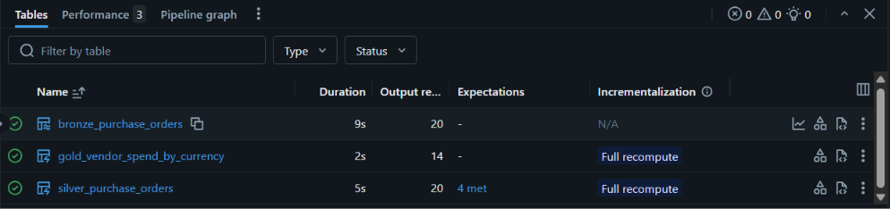
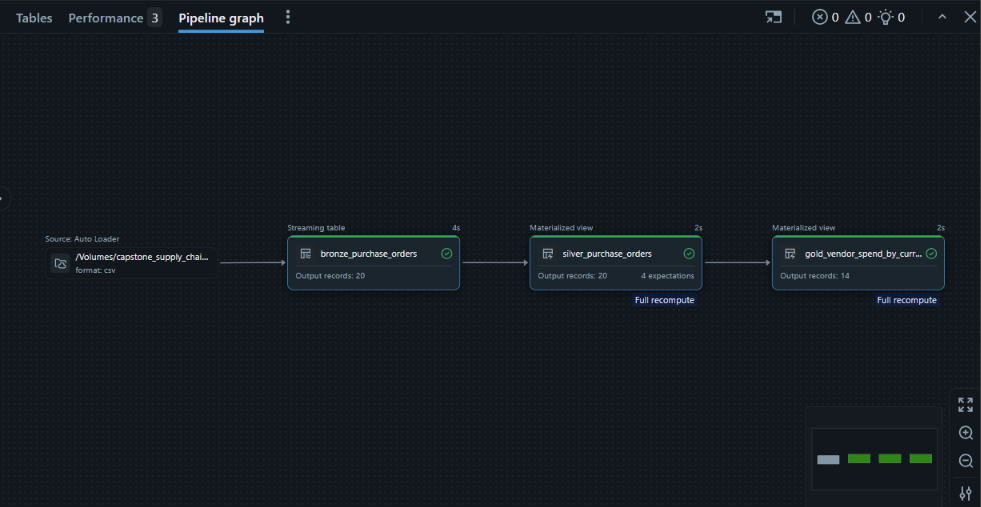
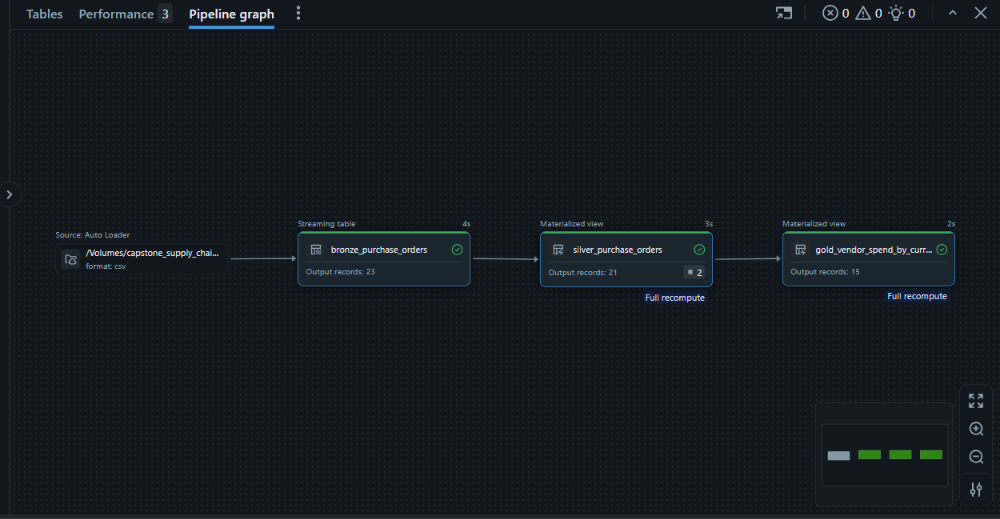

## Orchestration
### Lakeflow Job: Supply Chain ETL Pipeline
- 13 notebook tasks with dependencies: 6 parallel Bronze tasks, then Silver, then Gold, then the KPI snapshot, with table comments reapplied last.
- Created with the Databricks SDK (`17_create_job`), running on serverless compute with one retry per task.
- Full run takes about 4 minutes. The daily 06:00 schedule is configured but paused, to save Free Edition quota.
- Every notebook overwrites its output, so reruns are safe (idempotent).

### Declarative Pipeline: purchase orders (`sdp_demo` schema)
- Bronze streaming table (Auto Loader) → Silver with data quality expectations → Gold spend per vendor and currency.
- Results match the notebook version exactly (20 / 20 / 14 rows).
- Test: a file with 1 valid and 2 invalid rows was loaded incrementally, [bronze 20 → 23, silver 20 → 21], and the expectations dropped the 2 bad rows. The file was then removed and a full refresh restored the original counts.
- Jobs vs pipelines: the job orchestrates everything (notebooks, ordering, retries), and the pipeline declares tables and quality rules. Real projects often use both.

## Declarative Automation Bundle and CI
The job and the pipeline are defined as files and deployed with a bundle:
- `databricks.yml`: bundle with a `dev` target (development mode).
- `resources/supply_chain_job.yml`: the 13-task ETL job (6 parallel Bronze tasks, Silver, Gold, KPI snapshot, Genie comments), serverless compute, daily schedule paused.
- `resources/supply_chain_pipeline.yml`: the declarative pipeline for purchase orders (writes to its own schema).
- Deployed and run from the workspace bundle panel; results match the earlier notebook and pipeline versions.

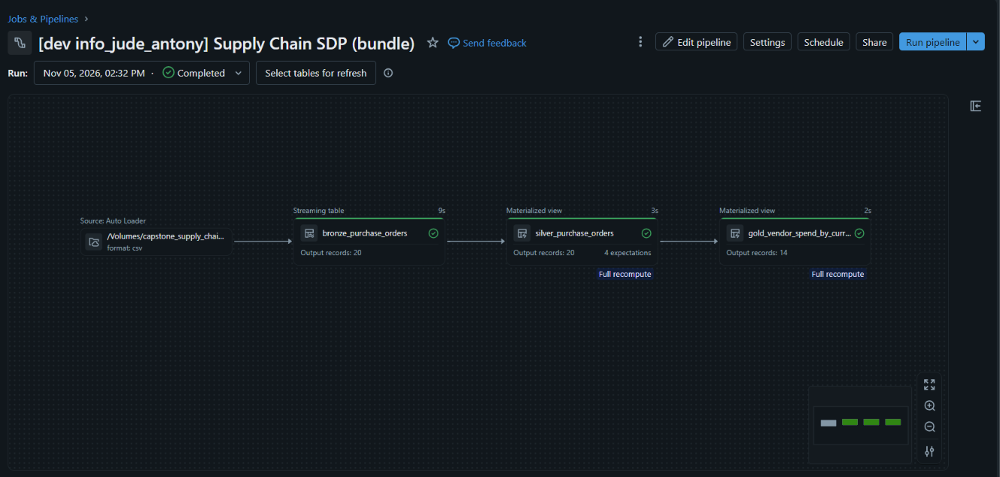
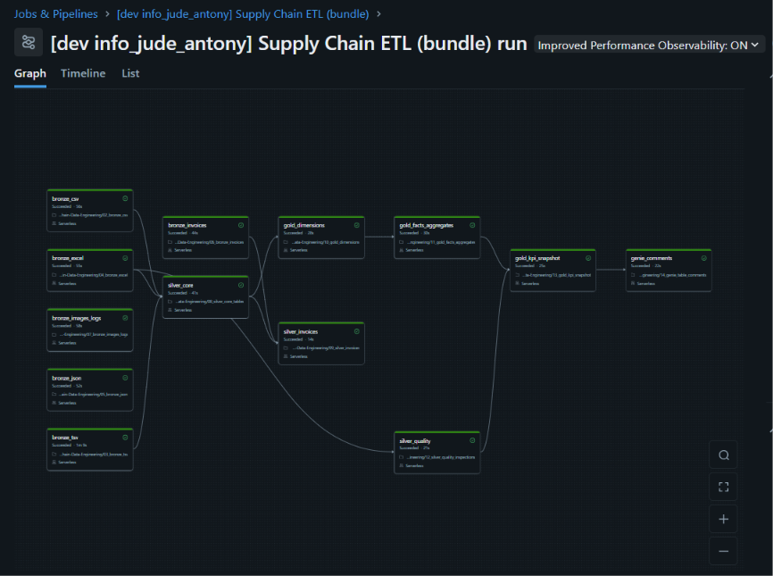

GitHub Actions (`.github/workflows/ci.yml`) runs on every push:
- Python syntax, notebook file and YAML checks
- Check that every file referenced by the bundle exists
- Secret scan for token patterns
- Fails if it checks almost nothing (a guard added after a first run passed while checking zero files)

Not done: staging and production targets (they need separate workspaces and catalogs), and automatic deployment from GitHub.

## Next
- CI/CD with Databricks Asset Bundles and GitHub Actions
- Silver cleaning for shipments (nested JSON), maintenance logs and image metadata
