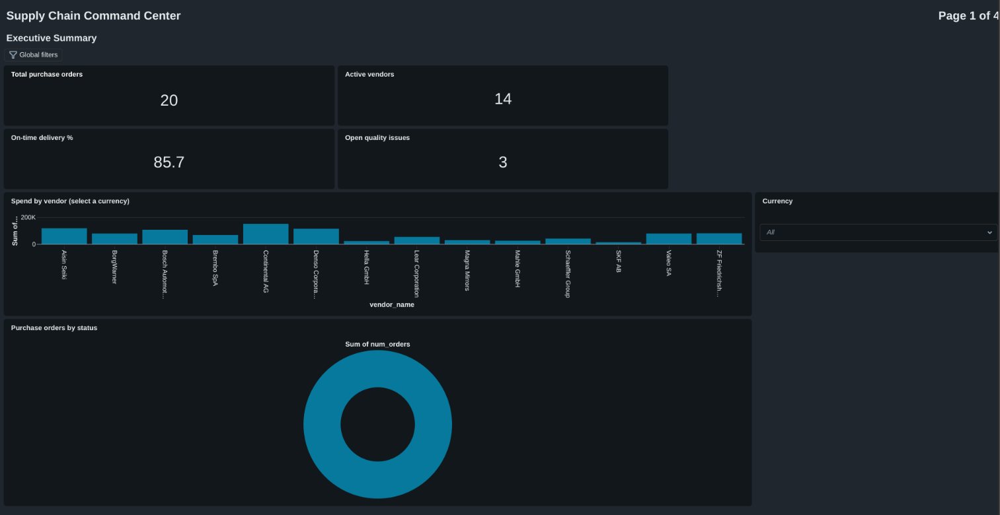
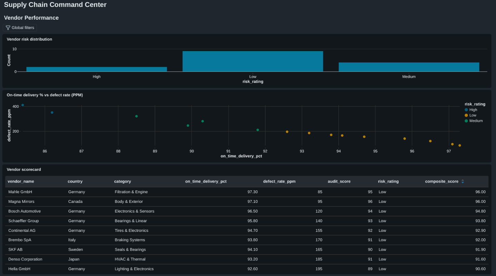
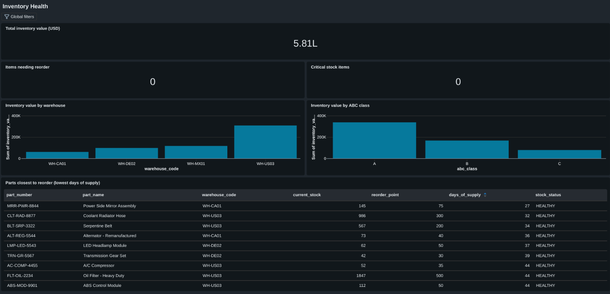
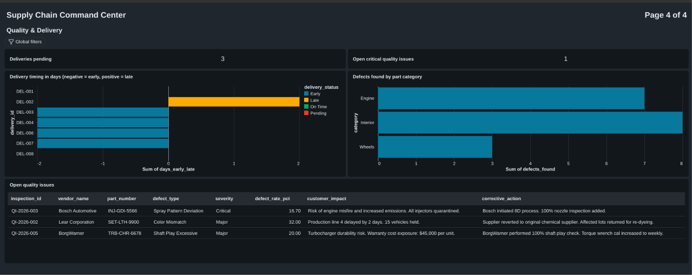

# SupplyChain-Data-Engineering
An End-to-End Supply Chain Data Engineering and AI Analytics Platform

## Progress

### Architecture
Medallion architecture on Databricks (Unity Catalog, Delta tables): raw files land in Volumes, then Bronze, Silver and Gold tables.

### Bronze layer (done)
- 11 raw Delta tables from CSV, TSV, Excel (3 sheets), nested JSON, invoice text files, image metadata and maintenance logs.
- Every table has audit columns (`_ingested_at`, `_source_file`, `_file_format`). Raw data is kept unchanged, except that spaces in Excel column names became underscores (Delta tables require this).
- Invoices are simulated PDF text files, and the image table is simulated metadata (no real image files).

### Silver layer (7 tables)
- Cleaned: purchase orders, vendors, inventory, deliveries, plants, quality inspections.
- Parsed with regex: invoice text turned into columns (invoice number, date, PO, vendor, total, currency, terms).
- Enforced types, snake_case names, deduplication and standardized values.
- Handled messy delivery data: mixed date formats, inconsistent dock names, blank values.
- Added business rules: stock status, defect rate, severity rank, open/closed and customer-impact flags.
- Checks: row counts, null checks, key uniqueness, and links to purchase orders.

### Gold layer (done)
- Dimensions: `dim_vendors`, `dim_parts`, `dim_plants` (keys unique, no orphan references).
- Fact: `fact_purchase_orders`, enriched with vendor and plant attributes.
- Aggregates: vendor scorecard (weighted composite score), inventory health, and vendor spend by currency.
- KPI snapshot (`gold_consolidated.supply_chain_kpi_snapshot`): 14 headline metrics, each reconciled against its source.
- The data contains 5 currencies, so spend is kept per currency and never added across them. Totals are reconciled against Silver, and there is no total-spend KPI.

### Data quality findings
- Delivery DEL-003 was received with no receiver recorded.
- Ambiguous date format (`06/10/2026`) resolved as month-first, using the surrounding dates.
- Sample inventory has no low-stock parts, so stock-status rules were tested with synthetic rows.
- The vendor scorecard does not yet use inspection results (a vendor with an open critical issue still ranks high).

## Dashboard: Supply Chain Command Center
Built with Databricks AI/BI Dashboards on the Gold layer (10 datasets, 4 pages).
Dataset queries are in `dashboard_datasets.sql`.

### Executive Summary

### Vendor Performance

### Inventory Health

### Quality and Delivery

Design notes:
- Spend is shown one currency at a time (the data has 5 currencies, and they are never added together).
- The inventory page highlights the parts closest to reorder, because all 25 parts are currently healthy.
- The delivery chart leaves pending deliveries blank instead of showing zero.
- Part-level inventory, deliveries and open quality issues are read from Silver, because there are no Gold tables for them yet.

## Genie agent
A Genie space ("Supply Chain Analyst") lets users ask questions in plain English over the Gold tables.
- Table and column comments were added to the Gold tables (`14_genie_table_comments`), because Genie relies on them.
- General instructions set the business rules, including that amounts in different currencies are never added or compared.
- Answers were validated against the source tables (`15_genie_validation`). Numbers and rankings matched exactly. Summary wording sometimes drifted (for example, overstating quality grades, or comparing spend across currencies), so narrative claims are checked too.

## Next
- Genie agent (natural-language questions on the Gold tables)
- Job scheduling to run the pipeline automatically
- CI/CD with GitHub Actions
- Silver cleaning for shipments (nested JSON), maintenance logs and image metadata